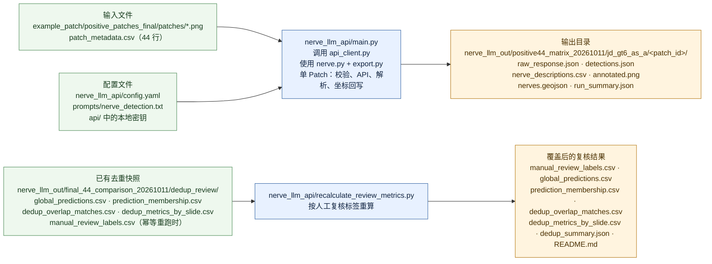

# llm_fuscc 项目总说明与对抗性审查记录

审查日期：2026-10-12。工作区：`E:\BRC\Projects\nerve_project\tmp\llm_fuscc`。

本次按只读要求检查了目录、脚本、配置、已有结果和各级 README；没有运行会写入结果的脚本，没有删除、移动或覆盖任何数据。按授权只补全了根目录 `AGENT.md` 和本文件。以下“现有结果”指当前磁盘上实际存在的快照；“可复现命令”只表示脚本设计上的调用顺序，本次没有执行。

## 项目目的与研究逻辑

主项目研究乳腺癌 H&E 组织切片中的神经识别：让多模态模型在固定坐标的 Patch 上识别可见神经，保存形态学证据和近似微环境描述，再把局部结果投回 WSI Level 0，处理跨 Patch 重复观察，并与 NDPA 人工几何参考进行位置级复核。研究逻辑分为五层：

1. **几何采样。** `nerve_patch_extractor` 从 NDPI 和 NDPA 读取 WSI Level 0 尺寸、MPP、扫描偏移和人工几何，生成固定尺寸 PNG。默认目标为 6144 px、0.5 μm/px、至少 20% 重叠；定向模式按 NDPA 几何居中取 Patch。NDPA 几何只用于采样和参考，不能自动证明语义上的“神经阳性”。
2. **固定输入集。** `example_patch/positive_patches_final/` 是已经整理好的 44 张 Patch 和元数据；FUSCCTNBC005 的 4 张 Patch 另有结果但不进入阳性汇总，排除后使用 40 行 `patch_metadata_no005.csv`。当前项目没有把提取器输出自动汇总为这套 44 张固定输入的脚本，因此它应视为已整理交付物。
3. **单 Patch 多模态推理。** `nerve_llm_api/main.py` 校验 PNG 尺寸、CSV 元数据、MPP 和 `patch_to_level0` 坐标变换；模型返回 JSON 后，程序生成像素坐标、WSI Level 0 坐标、多边形/椭圆标注、CSV、GeoJSON 和调用摘要。距离带由 bbox/椭圆近似，不能当作真实神经外缘或 PNI 诊断。
4. **Patch 级对照。** `generate_final_comparison.py` 读取每张 Patch 的模型结果，并从历史 `slide_metadata.json` 恢复该 Patch 内全部可见 NDPA 轮廓；输出对照图、manifest、位置指标、polygon IoU/Dice 诊断和人工待复核候选。对象定位与边界重合应分开解读。
5. **WSI 级去重与人工复核。** `deduplicate_and_stitch.py` 使用 WSI Level 0 几何，把同一切片不同 Patch 的重复观察按交集面积/较小多边形面积阈值 0.50 聚类；同一 Patch 内多根预测不合并。随后用 polygon IoU≥0.10 建立一对一人工重叠关系，`recalculate_review_metrics.py` 将人工复核标签写回去重结果。118 条 Patch 观察因此不能直接当作 118 根独立神经。

`mllm_bbox` 是另一个独立实验：用单张肾脏 H&E 图和 37 个手工框评测多模态模型的框选、耗时和费用。它不使用乳腺神经 Patch、NDPI/NDPA、WSI 坐标或本项目的去重指标。

## 当前可执行主流程与项目层级

流程图从当前仍存在的固定 Patch 和结果快照开始；缺少原始 WSI、历史 `slide_metadata.json` 或测试 fixture 的步骤放在图后单独说明。



主链的代码和文件关系是：固定 PNG/CSV → `main.py`（配合 `api_client.py`、`nerve.py`、`export.py`）→ 每个 Patch 的六类结果；已有 `dedup_review` → `recalculate_review_metrics.py` → 复核后的 CSV/JSON/README。`example_patch/positive_patches_final/` 是已经整理好的 44 张固定输入，不是当前代码自动汇总生成的中间目录。

### 当前无法重跑的步骤（不放入上图）

- `nerve_patch_extractor/main.py`、`wsi.py`：代码仍在，但当前工作区缺少原始 NDPI/NDPA，因此不能从 WSI 重新生成 Patch。
- `generate_final_comparison.py`：需要 `nerve_patch_extractor/tmp/positive_all_2048`、`positive_large_4096` 中的历史 `slide_metadata.json`；这些文件已清空。
- `deduplicate_and_stitch.py`：同样需要上述历史 `slide_metadata.json` 才能恢复完整人工参考；当前 `dedup_review` 只能作为已有快照读取。
- `evaluate.py`：代码仍在，但当前 `nerve_llm_api/tmp` 中没有旧的 prediction/ground-truth fixture；需要另行提供本地 JSON。
- 历史 q85 API 传输 JPEG 和 mock fixture 也在 `nerve_llm_api/tmp`，目前不能复核原始传输字节或直接复跑旧 mock 命令。

代码层目前仍在：`nerve_patch_extractor/` 含 `main.py`、`wsi.py`，`nerve_llm_api/` 含 `main.py`、`api_client.py`、`nerve.py`、`export.py`、`evaluate.py`、`generate_final_comparison.py`、`deduplicate_and_stitch.py` 和 `recalculate_review_metrics.py`。`example_patch/` 是 Patch 输入/元数据层，`nerve_llm_out/` 是模型请求和后处理结果层。

## 目录和各目录怎么用

| 目录 | 作用 | 主要入口/当前状态 |
|---|---|---|
| `api/` | 京东云、OpenRouter 的接口说明和本地密钥文件 | 没有脚本；不要在文档或日志中复制密钥 |
| `example_patch/positive_patches_final/` | 44 张固定 Patch、44 行元数据、清单、8 张切片总览图；另有排除 005 后的 40 行文件 | 下游模型输入；当前可直接读取 |
| `nerve_patch_extractor/` | WSI/NDPA 解析、Patch 读取、MPP/组织过滤、坐标变换 | `main.py`、`wsi.py`；当前 `tmp/` 为空 |
| `patch_output/` | 提取器默认输出位置 | 当前为空；不要与已有结果目录复用 |
| `nerve_llm_api/` | 单 Patch API、离线评估、Patch 对照、WSI 去重 | `main.py`、`evaluate.py`、`generate_final_comparison.py`、`deduplicate_and_stitch.py`、`recalculate_review_metrics.py`；当前 `tmp/` 为空 |
| `nerve_llm_out/` | 已有模型推理和去重结果 | `positive44_matrix_20261011/jd_gt6_as_a/` 与 `final_44_comparison_20261011/dedup_review/` |
| `mllm_bbox/` | 独立肾小管单图模型评测 | `repo/scripts/` 和 `results/`；不要接入乳腺神经主链 |
| 根目录 `tmp/` | 本次任务的临时区 | 当前为空 |

原始 `FUSCCTNBC002.ndpi` 和 `FUSCCTNBC002.ndpi.ndpa` 当前不在本工作区根目录；提取器 README 中的 `E:\BRC\Projects\nerve_project\FUSCC_WSI` 是项目外数据位置。因而现状只能直接使用已经整理好的 PNG/CSV 和已有结果，不能从本目录独立重跑 WSI 提取。

## 推荐运行顺序（复现时使用，本次未执行）

### 0. 先确认 Conda 环境

项目约定使用已存在的 `brc_nerve_small`，不在本次任务中安装依赖：

```powershell
& 'D:\software\Anaconda\Scripts\conda.exe' env list
& 'D:\software\Anaconda\Scripts\conda.exe' run -n brc_nerve_small python --version
```

提取器实际依赖 OpenSlide、NumPy、Pillow；API 依赖见 `nerve_llm_api/requirements.txt`（Pillow、PyYAML、requests、Pydantic、Shapely）。运行前应先确认这些包在所选环境中可导入。

### 1. 提取器自测和 WSI/NDPA 提取

不读 WSI、也不写结果的内置自测：

```powershell
& 'D:\software\Anaconda\Scripts\conda.exe' run -n brc_nerve_small python 'E:\BRC\Projects\nerve_project\tmp\llm_fuscc\nerve_patch_extractor\main.py' --self-test
```

如果项目外的 WSI 与 NDPA 可用，应每次指定一个新的空输出目录；提取器使用独占创建模式，复用已有非空输出会失败：

```powershell
& 'D:\software\Anaconda\Scripts\conda.exe' run -n brc_nerve_small python 'E:\BRC\Projects\nerve_project\tmp\llm_fuscc\nerve_patch_extractor\main.py' --slide 'E:\BRC\Projects\nerve_project\FUSCC_WSI\FUSCCTNBC002.ndpi' --ndpa 'E:\BRC\Projects\nerve_project\FUSCC_WSI\FUSCCTNBC002.ndpi.ndpa' --output 'E:\BRC\Projects\nerve_project\tmp\llm_fuscc\nerve_patch_extractor\tmp\directed_002_1024' --patch-size 1024 --target-mpp 0.5 --overlap 0.2 --ndpa-positive
& 'D:\software\Anaconda\Scripts\conda.exe' run -n brc_nerve_small python 'E:\BRC\Projects\nerve_project\tmp\llm_fuscc\nerve_patch_extractor\main.py' --verify --output 'E:\BRC\Projects\nerve_project\tmp\llm_fuscc\nerve_patch_extractor\tmp\directed_002_1024'
```

输出目录通常包括 `patches/*.png`、`patch_metadata.csv`、`grid_metadata.csv`、`slide_metadata.json`、`extraction_summary.json`、预览图和 `verification.json`。这些是提取器的原始结果；项目没有自动把它们整理成 `positive_patches_final/` 的 44 张固定输入。

### 2. 单 Patch API 推理

当前有效输入必须显式使用 `positive_patches_final` 路径和对应 CSV；根目录下的 `example_patch/patches` 并不存在。以下是无费用预检查示例，但它仍会在指定输出目录写入摘要文件：

```powershell
& 'D:\software\Anaconda\Scripts\conda.exe' run -n brc_nerve_small python 'E:\BRC\Projects\nerve_project\tmp\llm_fuscc\nerve_llm_api\main.py' --image 'E:\BRC\Projects\nerve_project\tmp\llm_fuscc\example_patch\positive_patches_final\patches\FUSCCTNBC002_patch_0004.png' --metadata-csv 'E:\BRC\Projects\nerve_project\tmp\llm_fuscc\example_patch\positive_patches_final\patch_metadata.csv' --model jd_gt6_as_a --output-dir 'E:\BRC\Projects\nerve_project\tmp\llm_fuscc\nerve_llm_out\new_run\jd_gt6_as_a' --dry-run
```

真实请求必须另加 `--execute`；API key 从 `api/` 或环境变量读取，不写入结果。`--api-image` 可以指定与原 PNG **完全同尺寸**的 JPEG/PNG 传输副本；本次历史 Astra 结果曾使用 `nerve_llm_api/tmp/positive44_jpeg_q85/`，该临时副本现在已清空，不能重新核对原始请求字节。

`main.py` 是单张入口，没有项目内的 44 张批处理脚本。批量推理的实际逻辑是对 44 个 PNG 重复调用该入口，并为每个模型指定独立的输出根目录；不要覆盖已有快照。每张 Patch 的六个结果文件为：

- `raw_response.json`：脱敏请求/响应、状态、重试、usage、时间和图片摘要；
- `detections.json`：Pydantic 校验后的检测、像素/WSI 坐标和验证信息；
- `nerve_descriptions.csv`：每根检测一行；
- `annotated.png`：Patch 内标注图；
- `nerves.geojson`：WSI Level 0 坐标的 QuPath Polygon；
- `run_summary.json`：状态、模型、检测数、token、耗时和成本字段。

`--mock-response`、离线测试 JSON 和测试图片原来位于 `nerve_llm_api/tmp`，当前已清空；不能把旧 README 中的 mock 命令当作当前可执行命令。

### 3. Patch 级离线评估和对照图

`evaluate.py` 只读本地预测和人工 JSON，不联网；输入文件需自行提供，当前 `tmp` 中没有旧 fixture：

```powershell
& 'D:\software\Anaconda\Scripts\conda.exe' run -n brc_nerve_small python 'E:\BRC\Projects\nerve_project\tmp\llm_fuscc\nerve_llm_api\evaluate.py' --prediction '<prediction.json>' --ground-truth '<ground_truth.json>' --coordinate-space normalized --iou-threshold 0.5 --output '<evaluation.json>'
```

`generate_final_comparison.py` 的设计顺序是读取 44 行 Patch 元数据、每张模型 `detections.json`，再从 `nerve_patch_extractor/tmp/positive_all_2048` 和 `positive_large_4096` 下的 `slide_metadata.json` 读取全部可见 NDPA。它会生成 `overlays/`、`comparison_manifest.csv`、`unmatched_candidates.csv`、`metrics.json`、`evaluation_report.md`、`review_cases/` 和目录 README。当前这些中间 `slide_metadata.json` 已不存在，因此本阶段只能阅读历史说明，不能从当前工作区安全重跑。

### 4. WSI 级去重和复核指标

设计上的顺序是：

```powershell
& 'D:\software\Anaconda\Scripts\conda.exe' run --no-capture-output -n brc_nerve_small python -u 'E:\BRC\Projects\nerve_project\tmp\llm_fuscc\nerve_llm_api\deduplicate_and_stitch.py' --metadata-csv 'E:\BRC\Projects\nerve_project\tmp\llm_fuscc\example_patch\positive_patches_final\patch_metadata.csv' --model-root 'E:\BRC\Projects\nerve_project\tmp\llm_fuscc\nerve_llm_out\positive44_matrix_20261011\jd_gt6_as_a' --output-dir 'E:\BRC\Projects\nerve_project\tmp\llm_fuscc\nerve_llm_out\final_44_comparison_20261011\dedup_review'
& 'D:\software\Anaconda\Scripts\conda.exe' run --no-capture-output -n brc_nerve_small python -u 'E:\BRC\Projects\nerve_project\tmp\llm_fuscc\nerve_llm_api\recalculate_review_metrics.py' --dedup-dir 'E:\BRC\Projects\nerve_project\tmp\llm_fuscc\nerve_llm_out\final_44_comparison_20261011\dedup_review'
```

第一步生成初始聚类、匹配、拼接图和摘要；人工复核标签确定后，第二步会覆盖去重目录中的 CSV、JSON 和 README。两步都会写文件，本次均未执行；第一步还依赖已清空的 `slide_metadata.json`，因此当前不能声称可以重建现有指标。

## 当前实际存在的结果

### 固定 Patch 输入

`example_patch/positive_patches_final/` 当前有 44 张 PNG、`patch_metadata.csv`、`sample_manifest.csv`、`extraction_summary.json`、8 张切片总览图及 `patch_overlay_index.csv`。`patch_metadata_no005.csv` 和 `sample_manifest_no005.csv` 是排除 FUSCCTNBC005 后的 40 行版本。总览图 README 明确说明 005 不绘制，但原始 44 行仍保留用于审计。

### Astra 单 Patch 结果

`nerve_llm_out/positive44_matrix_20261011/jd_gt6_as_a/` 保存 44 个 Patch 的六类输出。静态核对结果为：40 个 `success`、4 个 FUSCCTNBC005 `success_no_detections`，全部结果合计 118 条检测观察。这里的 118 是 Patch 观察数，后续必须去重。

### 当前可用的 WSI 级最终快照

`nerve_llm_out/final_44_comparison_20261011/dedup_review/` 当前实际保留：

- 44 张 `patch_overlays/`；
- 9 张 `stitched/` 切片概览；
- `prediction_membership.csv`（118 条观察到全局簇的归属）；
- `global_predictions.csv`（69 个 WSI 候选）；
- `dedup_overlap_matches.csv`、`dedup_metrics_by_slide.csv`；
- `manual_review_labels.csv`（69 个候选的复核标签）；
- `dedup_summary.json` 和目录 README。

当前摘要的复核前口径是：40 个与人工区域 IoU≥0.10 的命中、29 个未被当前人工参考覆盖的候选、Recall 1.0000、严格 Precision 0.5797、严格 F1 0.7339。复核后口径是：60 个扩展参考中的有效检出、9 个确认非神经候选、Recall 1.0000、严格 Precision 0.8696、严格 F1 0.9302。复核后新增参考不是原始 NDPA 金标准，不能把该 Recall 当作未扩展金标准上的传统 Recall。

### 独立的 `mllm_bbox` 结果

`mllm_bbox/results/20261007-main/` 是 8 个模型各 3 次主实验：raw/parsed/overlays 各 24 个文件，GeoJSON 25 个（含人工 GT）；`20261007-native/` 是 Gemini/Kimi 各 3 次补测：raw/parsed/overlays 各 6 个，GeoJSON 7 个（含 GT）。这些是单图、探索性肾小管框选快照，不能外推到乳腺神经任务。原目录 README 使用 `uv venv`，与本项目规定的 Conda-only 工作环境不一致；如需复算，先按本机 Conda 规范确认环境和依赖，不要自动安装。

## 结果文件由哪些脚本生成

| 结果 | 设计生成脚本 | 当前判断 |
|---|---|---|
| 提取目录中的 PNG、CSV、`slide_metadata.json`、`verification.json` | `nerve_patch_extractor/main.py` | 代码负责生成；当前默认 `patch_output/` 和 `nerve_patch_extractor/tmp/` 为空 |
| `positive_patches_final` 的 44 张固定 Patch、清单、总览图 | 当前代码中没有完整汇总脚本 | 已整理快照，不能说由一次现有脚本自动重建 |
| 每张 Patch 的六类 API 输出 | `nerve_llm_api/main.py` | 当前 Astra 结果存在；批处理由外部重复调用完成 |
| `comparison_manifest.csv`、Patch 对照图、`metrics.json`、报告、待复核候选 | `generate_final_comparison.py` | 旧结果父目录当前已清理，且重跑缺 `slide_metadata.json` |
| `dedup_review` 初始聚类、拼接和摘要 | `deduplicate_and_stitch.py` | 当前目录保留结果；重跑依赖已清空中间元数据 |
| 复核标签、复核后摘要和逐列 CSV | `recalculate_review_metrics.py` | 当前目录字段已是复核后 schema |
| 通用离线 bbox/形状评估 JSON | `evaluate.py` | 只有提供本地 prediction/GT 才能运行 |
| `mllm_bbox/results` raw、parsed、scores、summary、overlays、GeoJSON | `run_models.py`、`evaluate_runs.py`、`export_qupath.py`、`check_models.py` | 属于独立肾小管实验；已有快照可读 |

## 审查结论

我只做了目录、文本、脚本和已有 JSON/CSV 的静态交叉核对，并检查了 Conda 环境列表；没有重跑会写结果的脚本，也没有修改代码。当前最可靠的使用方式是把 `positive_patches_final`、Astra 单 Patch 输出和 `dedup_review` 当作三组已有快照阅读；如需重建，应先补齐原始 WSI/NDPA、历史 `slide_metadata.json` 和同尺寸 API 传输图像，再用新空输出目录逐阶段运行并重新核对数量、坐标和状态。

## 错误部分

以下问题是本次静态审查能够由当前文件和目录直接确认的错误或冲突；本次不修改代码，只在此记录。

1. **阻断 WSI 提取重跑。** 当前工作区根目录不存在 `FUSCCTNBC002.ndpi` 和 `FUSCCTNBC002.ndpi.ndpa`，但 `nerve_patch_extractor/main.py:242-243` 的默认路径指向根目录；`nerve_patch_extractor/README.md` 的示例又指向项目外 `FUSCC_WSI`。从当前工作区不能直接重新提取 Patch。
2. **阻断 Patch 级对照和 WSI 去重重跑。** `generate_final_comparison.py:30,140-150` 只从 `nerve_patch_extractor/tmp/positive_all_2048`、`positive_large_4096` 的 `slide_metadata.json` 读取全部可见 NDPA；`deduplicate_and_stitch.py:144-160` 复用同一来源。上述目录当前为空，工作区也没有其他 `slide_metadata.json`，因此现有 69 个候选结果只能作为历史快照读取，不能从现状独立重建；在缺失元数据时继续运行还有把人工 GT 读成空集、生成误导性指标的风险。
3. **API 默认路径错误。** `nerve_llm_api/config.yaml:2-3` 和 `main.py` 的默认解析指向不存在的 `../example_patch/patch_metadata.csv` 与 `../example_patch/patches/`。实际文件在 `example_patch/positive_patches_final/`；不显式传 `--metadata-csv` 和正确 PNG 路径的 dry-run/真实运行会失败。
4. **API 测试命令失效。** `nerve_llm_api/README.md` 中的 mock/评估示例引用 `nerve_llm_api/tmp` 下的 fixture 和 q85 JPEG；该 `tmp` 已清空。历史 `run_summary.json` 的 `api_image_path` 也指向已不存在的传输副本，不能复核当次 JPEG 字节。
5. **最终对照目录与旧文档不一致。** `nerve_llm_out/final_44_comparison_20261011/` 当前只剩 `dedup_review/`；旧 README/REPORT 所说的 `overlays/`、`comparison_manifest.csv`、`metrics.json`、`evaluation_report.md`、`unmatched_candidates.csv` 和 `review_cases/` 不在当前目录。它们只能标为历史已清理结果，不能当作当前存在文件。
6. **去重摘要 schema 已漂移。** `deduplicate_and_stitch.py` 初始摘要曾写入 `simple_iou_01_metrics`，随后 `recalculate_review_metrics.py` 重写 `dedup_summary.json`；当前 JSON 使用 `before_manual_review`/`after_manual_review`，没有 `simple_iou_01_metrics`。旧 README 对字段的描述已过时。
7. **阳性输入汇总缺少自动化来源。** 当前代码没有把提取器输出自动汇总、筛选、复制成 `positive_patches_final/` 44 张固定 Patch及其 `sample_manifest`/总览索引的脚本；因此不能把该目录描述成由当前代码单命令生成。CSV 中的 `source_metadata` 仍指向已清空的 `nerve_patch_extractor/tmp/positive_all_2048` 或 `positive_large_4096`，所以行内坐标还可读，但上游提取文件无法再做逐行 provenance 核验。
8. **历史报告引用了当前不存在的结果。** `nerve_llm_api/REPORT.md` 引用 `nerve_llm_out/model_tests/final_audit_20261011_v2/`，但当前 `nerve_llm_out/` 没有 `model_tests` 目录；报告中的早期 API 失败/解析失败叙述也不应覆盖当前 Astra 快照中 40 个成功和 4 个合法空检测的状态。
9. **运行规范存在冲突。** `mllm_bbox/README.md` 使用 `uv venv`/`uv pip install`，与本工作区要求统一使用固定 Conda 环境的 AGENT 约定冲突；当前 `mllm_bbox/repo/.venv` 也不存在，因此该 README 不能直接作为本工作区的软件安装指令。
10. **输出目录复用风险。** `nerve_patch_extractor/main.py` 的 JSON/CSV/PNG 使用独占创建模式；对已有非空输出目录重新运行会抛出 `FileExistsError`。复现时必须指定新的空 `tmp` 子目录，并在确认结果后再做人工整理。
